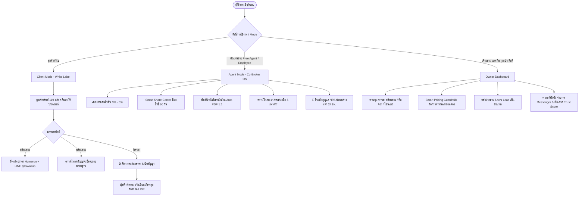
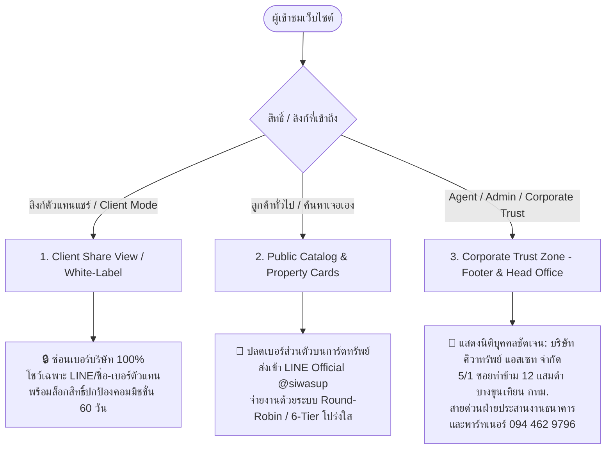

# 📑 Siwasup Co-Broker OS: สรุปผลงาน Phase 1 & ชุดโครงร่างพรีเซนต์ทีมศิวาทรัพย์ (Executive Pitch Kit)

**โปรเจกต์:** ระบบบริหารคลังทรัพย์รีโนเวท & เครือข่ายตัวแทนขาย (Siwasup Co-Broker & Renovation OS)  
**ผู้วางระบบ:** ณัฐ ระวังภัย (ต้น / Nassty - Senior IT Consultant)  
**ทีมบริหารเป้าหมาย:** ครูเจี๊ยบ (กูล), คุณบัว (ภมรมาศ), พี่ลิลลี่ (Admin กุญแจ NPA)  
**Live URL:** [https://thenassty-cpu.github.io/siwasup-cobroker-os/](https://thenassty-cpu.github.io/siwasup-cobroker-os/)  
**วันที่บันทึก:** 19 ตุลาคม 2569  

---

## 🚀 1. สรุปผลงานวันนี้ (19 ต.ค. 2569)

วันนี้ถือเป็น Milestone สำคัญในการ **ยกระดับระบบจากเว็บแสดงทรัพย์ธรรมดา สู่ระดับ Enterprise Co-Broker Platform** ที่พร้อมรองรับผู้ใช้จริงทั้งฝั่งลูกค้า ตัวแทน และเจ้าของ:

| ลำดับ | ภารกิจที่ทำสำเร็จ | รายละเอียด & ผลลัพธ์ทางเทคนิค |
| :---: | :--- | :--- |
| **1** | **กวาดล้างทรัพย์ Sold Out ถาวร** | สแกนและลบ 16 รายการที่มีตรายางสีแดง Sold out ออกจาก `siwasup_all_properties.json` และ `.js` เหลือ **119 หลัง คลีน 100%** |
| **2** | **ระบบล็อกบ้าน "ติดจอง" ใน Client Mode** | • ล็อกปุ่ม "เสนอราคา" (Disabled) ป้องกันลูกค้าสับสน<br>• เปลี่ยนปุ่มเป็น `💬 สอบถามคิวสำรองผ่าน LINE Official`<br>• ซ่อนการดาวน์โหลดสัญญาจะซื้อจะขายอัตโนมัติ |
| **3** | **คลีน Visual Noise ป้าย "New"** | ปลดตรรกะเหมาเข่งเดิมที่แปะ New ทุกการ์ด เปลี่ยนเป็นแสดง `New` สีแดงเฉพาะบ้านใหม่จริง 6 หลังแรก นอกนั้นปล่อยคลีนสไตล์ Homerun |
| **4** | **ติดตั้ง Prototype ระบบเบิกกุญแจ NPA (พี่ลิลลี่)** | • เพิ่มปุ่มลัด `🔑 เบิกกุญแจ (Demo)` บน Header และ Detail Modal<br>• จำลอง 3 แท็บ: ยื่นขอเบิกพร้อมคำนวณ Lead Time, Live Tracker ติดตาม Messenger, และแผงตัดเกรด 1-Click โดยพี่ลิลลี่<br>• แปะป้ายและจด Note รอส่งต่อ *Argon* พัฒนาต่อ |
| **5** | **Deploy ขึ้น Production** | Commit (`2fb602f`) และ Push ขึ้น GitHub Pages เรียบร้อย ใช้งานได้ทันที |

---

## ⚡ 2. ประเมินประสิทธิภาพการทำงานในเฟสนี้ (Performance & Architecture Audit)

> **ภาพรวมประสิทธิภาพ: ยอดเยี่ยมมาก (เกรด A+)**  
> สถาปัตยกรรมปัจจุบันถูกออกแบบมาให้ **รันเร็ว ไร้เซิร์ฟเวอร์หลังบ้าน (Zero Backend Cost) และไม่กิน Token**

1. **ความเร็วการตอบสนอง (Instant Response Time):**
   - การทำงาน 100% เป็น Client-side JavaScript ทำให้การค้นหา, กรองราคา, สลับโหมด 5 สิทธิ์, และเปิด Modal ทำงานในระดับ **0-50 มิลลิวินาที (Instant Click)** ไม่หน่วงเน็ต
2. **การประหยัด Token และความง่ายในการดูแลโค้ด (Maintainability):**
   - การสกัด Modals 10 ชุดออกจาก `index.html` ไปไว้ใน `modals.js` ช่วยลดโค้ดลงกว่า 500 บรรทัด ทำให้เวลาเปิดแชทใหม่หรือแก้ไข UI ทำได้อย่างรวดเร็วและไม่สิ้นเปลือง Token
3. **White-Label Security (เกราะป้องกันตัวแทนโดนข้ามหัว):**
   - ระบบแปลงชื่อทรัพย์ ป้ายธนาคาร และตัดคำว่า "NPA" ออกทั้งหมดในโหมดลูกค้าอย่างสมบูรณ์แบบ ลูกค้าไม่รู้ต้นทางและไม่สามารถโทรตรงหาธนาคารได้
4. **ความพร้อมสวมต่อ Backend (Supabase Ready):**
   - โครงสร้าง Data Schema ออกแบบให้ล้อตาม `supabase_schema_phase1.sql` 100% เมื่อถึงเวลาต่อ Database จริง แค่เปลี่ยนจากตัวแปร JS ไปเป็น `supabase.from('properties').select()` ได้ทันที

---

## ⏳ 3. สิ่งที่เหลือสำหรับเฟสนี้ ก่อนขยับไป Phase 2

1. **ทดสอบใช้งานจริง (Field Usability Test):**
   - ให้บัวลองเปิดบนมือถือ และเทสต์ฟังก์ชันมัดรวมทรัพย์ (Instant Bundle) ส่งเข้าแชท LINE จริง
   - ให้พี่ลิลลี่ดูหน้าตา Prototype ระบบเบิกกุญแจและระบบตัดเกรด เพื่อขอฟีดแบ็กหน้างาน
2. **รวบรวม Requirement กุญแจ NPA:**
   - สรุปกติกาเงินมัดจำ, รอบการวิ่งของ Messenger, และธนาคารเป้าหมายหลัก (SCB / KBANK / SAM) เตรียมส่งมอบให้ Argon

---

## 🎯 4. ผังโครงสร้างระบบ (System Architecture & User Journey)



---

## 📊 5. โมเดลการให้คะแนนตัวแทน (Agent Scoring & Gamification Model)

โมเดลแบ่งเป็น **2 มิติ** เพื่อคัดกรองตัวแทนคุณภาพสูง:

### มิติที่ 1: แต้มกิจกรรมและผลงาน (Activity & Sales Points)
ใช้ขับเคลื่อนตารางอันดับ (Leaderboard) และปลดล็อกสิทธิพิเศษคอมมิชชั่น:
* 📤 **แชร์ทรัพย์ผ่าน Smart Share:** `+5 แต้ม`
* 🖨️ **ดาวน์โหลดไฟล์ป้ายไวนิลไปพิมพ์:** `+5 แต้ม`
* 🎟️ **สแกน QR เข้าร่วมประชุม/อบรม:** `+10 แต้ม`
* 📍 **ถ่ายภาพติดป้ายหน้าบ้านพร้อม GPS Check-in:** `+15 แต้ม`
* 🏡 **ส่งทรัพย์เข้าคลังฝากขาย:** `+20 แต้ม`
* 🏆 **ปิดการขายสำเร็จ (โอนกรรมสิทธิ์):** `+100 แต้ม`

### มิติที่ 2: ความน่าเชื่อถือเรื่องกุญแจ NPA (Agent Trust Score โดยพี่ลิลลี่)
ฐานคะแนนเต็ม `100 คะแนน` เพื่อคัดกรองสิทธิ์เบิกกุญแจธนาคาร:

| เกณฑ์ประเมิน (โดยพี่ลิลลี่ & Messenger) | ผลต่อคะแนน | เงื่อนไข |
| :--- | :---: | :--- |
| **ตรงเวลาตามนัด (Punctual)** | `+5` | มารอ Messenger ณ จุดนัดพบหน้างาน ไม่ปล่อยให้รอ |
| **ดูแลทรัพย์สินและกุญแจครบ (Asset Care)** | `+5` | กุญแจครบ 100% ไม่หักไม่หาย ล็อกบ้าน ปิดน้ำไฟเรียบร้อย |
| **ส่งรายงานผลการพาชมไว (Quick Report)** | `+3` | ส่ง Feedback ความสนใจของลูกค้าภายใน 24 ชม. |
| **แจ้งนัดล่วงหน้าตามเกณฑ์ (Planning)** | `+2` | แจ้งล่วงหน้าเกิน 24 ชั่วโมง |
| **มาสายเกิน 20 นาที (Late)** | `-5` | Messenger ยืนรอหน้างาน |
| **ยกเลิกกะทันหัน / เบี้ยวนัด (No-show)** | `-15` | แจ้งยกเลิกน้อยกว่า 2 ชม. ก่อนเวลานัด |
| **ทำกุญแจธนาคารชำรุด/สูญหาย (Key Lost)** | `-30` | ระงับสิทธิ์การเบิกทันที ต้องชดใช้ค่าทำกุญแจใหม่ |

> **ระดับขั้น (Trust Tiers):**
> * 🌟 **ระดับ Fast-Track (85 - 100 แต้ม):** เบิกกุญแจได้ทันที ฟรีค่าบริการ ไม่ต้องวางเงินประกัน
> * 🟡 **ระดับ Standard (70 - 84 แต้ม):** ต้องรอพี่ลิลลี่โทรยืนยันลูกค้าก่อนจ่ายงาน
> * 🔴 **ระดับ Watchlist (< 70 แต้ม):** ต้องวางเงินประกันกุญแจ 1,000 บาท หรือต้องให้เจ้าหน้าที่ศิวาทรัพย์ประกบ

---

## 🛡️ 6. ยุทธศาสตร์ Dynamic Contact Routing: ปลดล็อกความน่าเชื่อถือองค์กร & ชนะใจเอเจนต์ 100%

### จุดวัดใจระหว่าง "ความน่าเชื่อถือบริษัท" vs "ความกลัวโดนข้ามหัวของเอเจนต์ (Fear of Bypass)"

การทำธุรกรรมบ้านและที่ดินมูลค่าหลักล้าน **ความน่าเชื่อถือของนิติบุคคล ที่ตั้งสำนักงาน และช่องทางติดต่อกลาง เป็นสิ่งจำเป็นอย่างยิ่ง** ต่อทั้งผู้ซื้อบ้าน, เจ้าของทรัพย์ฝากขาย, และสถาบันการเงินเจ้าของพอร์ต NPA 

แต่มุมมองของ **ตัวแทนขาย (Co-broker / Agent)** การมีเบอร์โทรศัพท์บริษัทแปะอยู่บนการ์ดทรัพย์หรือหน้าเว็บที่เขาส่งให้ลูกค้า คือ **"จุดตาย"** ที่ทำให้นายหน้าเลิกส่งลิงก์เว็บให้ลูกค้าทันที เพราะกลัวลูกค้าแอบโทรเข้าบริษัทโดยตรงเพื่อขอต่อราคาและตัดสิทธิ์ค่านายหน้า (Bypass)

> **ทางออกของศิวาทรัพย์:** ไม่ใช่การ "ลบเบอร์ทิ้งจนกลายเป็นเว็บผี" และไม่ใช่การ "แปะเบอร์บริษัทหราจนเอเจนต์หนี"  
> แต่คือการใช้ระบบ **"Dynamic Contact Routing" (สลับช่องทางติดต่อตามสถานะสิทธิ์และลิงก์อัตโนมัติ)**



---

### โครงสร้างการแบ่งบริบท 3 ระดับ (The 3-Context Contact Architecture)

| บริบทการใช้งาน | สิ่งที่ระบบแสดงผล | เหตุผลทางจิตวิทยา & ผลลัพธ์ทางธุรกิจ |
| :--- | :--- | :--- |
| **1. โหมดลิงก์ที่เอเจนต์แชร์ให้ลูกค้า**<br>*(Client Share View / White-Label)*<br>เช่น `...?ref=AG042` หรือ Client Mode | **ห้ามมีเบอร์บริษัทเด็ดขาด!**<br>• ปุ่ม CTA เป็น `ติดต่อตัวแทนผู้ดูแลผ่าน LINE (คุ้มครองสิทธิ์ 60 วัน)`<br>• ซ่อนเบอร์โทรศัพท์บน Header และแปลงเบอร์ใน Footer เป็นช่องทางติดต่อตัวแทน | **เอเจนต์กล้าแชร์ลิงก์ 100%:**<br>เอเจนต์มั่นใจว่าแพลตฟอร์มทำหน้าที่เป็น "นามบัตรดิจิทัลสุดหรู" ให้เขา ไม่ใช่คู่แข่งแย่งลูกค้า ลูกค้ากดทางไหนก็เข้าตัวแทนคนนั้นพร้อมติด Tag `[ผู้แนะนำ: Sxx]` |
| **2. หน้าแรก / การ์ดทรัพย์โหมดปกติ**<br>*(Public Catalog & Property Cards)* | **ไม่โชว์เบอร์โทรตรงๆ บนการ์ดทรัพย์**<br>• มีเฉพาะปุ่ม `นัดชมทรัพย์` / `ยื่นเสนอราคา`<br>• ทุก Action ส่งเข้า **LINE Official (@siwasup)** | **ป้องกันการแอบรับเคสส่วนตัว & จัดคิวโปร่งใส:**<br>ลูกค้าที่ทักเข้ามาจะถูกบันทึก Timestamp และผูกเข้าสู่ระบบคิวกลาง (Round-Robin) ให้แอดมินบัวจ่ายงานตามลำดับ 6-Tier ของตัวแทนอย่างเป็นธรรม ตรวจสอบย้อนหลังได้ |
| **3. ส่วนท้ายเว็บ & แผงบริหาร**<br>*(Corporate Trust Zone - Footer / Admin)* | **แสดงข้อมูลองค์กรครบถ้วนจัดเต็ม:**<br>• นิติบุคคล: บริษัท ศิวาทรัพย์ แอสเซท จำกัด<br>• สำนักงาน: 5/1 ซอยท่าข้าม 12 ถนนท่าข้าม บางขุนเทียน กทม.<br>• เบอร์กลาง: `094 462 9796`<br>*(ระบุชัด: ติดต่อสำนักงานใหญ่ / ฝ่ายประสานงานธนาคารและพาร์ทเนอร์)* | **สร้างความเชื่อถือสูงสุดทางสถาบัน:**<br>• ธนาคารพันธมิตร (NPA) และเจ้าของทรัพย์ฝากขายมั่นใจว่ามีตัวตนจริง<br>• ตัวแทนที่จะมาร่วมงานอุ่นใจว่าบริษัทมั่นคง จ่ายคอมมิชชั่นชัวร์ ไม่เบี้ยว<br>• ตัวแทนยอมรับได้เพราะระบุชัดเจนว่าเป็น "เบอร์ฝ่ายพาร์ทเนอร์/สำนักงานใหญ่" ไม่ใช่เบอร์เซลล์ขายแข่ง |

---

### สรุปคุณค่าที่ศิวาทรัพย์ส่งมอบให้ทีมผู้บริหาร (กูล & บัว)
1. **บริษัทได้ Brand Equity & Institutional Trust:** มีตัวตน มีที่ตั้ง มีเบอร์กลางถูกต้องตามกฎหมาย พร้อมดีลกับธนาคารและสถาบันการเงิน
2. **เอเจนต์ได้ Partner Loyalty & Shield:** ตัวแทนไม่ต้องพกโบรชัวร์กระดาษ กล้าใช้เว็บศิวาทรัพย์เป็นเครื่องมือทำมาหากิน เพราะระบบ "การันตีไม่ข้ามหัว"
3. **ระบบหลังบ้านได้ Data Centralization:** ลูกค้าทุกคนที่สนใจซื้อทรัพย์ต้องผ่าน Touchpoint ที่ระบบบันทึกได้ ไม่มี Lead ตกหล่นหรือรั่วไหล

---

## 🎤 7. โครงร่างสไลด์นำเสนอ (Pitch Deck Structure สำหรับกูล & บัว ที่ออฟฟิศ)

```
[Slide 1] หน้าปก: "Siwasup Co-Broker & Renovation OS"
          - ก้าวต่อไปของศิวาทรัพย์: จากคลังบ้านรีโนเวท สู่ Platform กองทัพตัวแทนอสังหาฯ ยุค 2026
          - ผู้บรรยาย: คุณต้น (Senior Advisor)

[Slide 2] ปัญหาหน้างานเดิม (Pain Points):
          - ทรัพย์ NPA ธนาคารมีเยอะ แต่จัดการยาก ข้อมูลกระจัดกระจาย
          - เอเจนต์กลัวโดนข้ามหัว: ลูกค้าเห็นป้ายแบงก์หรือเบอร์บริษัทแล้วโทรตรงจนถูกตัดคอมฯ
          - กุญแจ NPA เบิกยาก มีความเสี่ยงสูญหาย และเสียเครดิตกับธนาคาร
          - งาน Operation ของบัวและพี่ลิลลี่ต้องคอยตอบไลน์มือหงิก

[Slide 3] ทางออก: Siwasup Co-Broker OS (Demo หน้าเว็บจริง)
          - โชว์โหมดลูกค้า (White-label): สวย คลีน สไตล์ Homerun ซ่อนชื่อแบงก์ 100%
          - โชว์ระบบล็อกบ้านติดจอง: ป้องกันข้อเสนอชนกัน เปลี่ยนเป็นคิวสำรอง
          - โชว์ระบบมัดรวมทรัพย์ (VIP Bundle): ส่งแคปชั่นให้ลูกค้าทาง LINE ภายใน 3 วินาที

[Slide 4] อาวุธลับของตัวแทน: พิมพ์ป้ายไวนิล Auto PDF & Smart Share
          - ตัวแทนกดพิมพ์ป้าย 1:1 พร้อมเบอร์โทรและรหัสของตัวเองได้ทันที
          - ป้ายมีระบบล็อกสิทธิ์ 60 วัน ลูกค้าสแกนซื้อ ใครแชร์คนนั้นได้คอมมิชชั่น

[Slide 5] ยุทธศาสตร์ชนะใจเอเจนต์: Dynamic Contact Routing (ได้ทั้งความน่าเชื่อถือบริษัท & ใจเอเจนต์ 100%)
          - ปลดล็อกปัญหาคลาสสิก: "ใส่เบอร์บริษัทแล้วเอเจนต์ไม่กล้าแชร์ลิงก์ vs ไม่ใส่เบอร์แล้วบริษัทดูไม่น่าเชื่อถือ"
          - โครงสร้าง 3 บริบทอัตโนมัติ:
            1) ลิงก์ที่เอเจนต์แชร์ (Client View): ซ่อนเบอร์บริษัท 100% ล็อกสิทธิ์เป็นชื่อ-เบอร์เอเจนต์
            2) การ์ดทรัพย์ทั่วไป: ไม่มีเบอร์ส่วนตัว ส่งเข้า LINE OA จัดคิวโปร่งใสผ่าน Round-Robin
            3) Footer องค์กร (Corporate Trust): แสดงที่ตั้งท่าข้าม 12 และเบอร์ประสานงานพาร์ทเนอร์/แบงก์ ชัดเจน
          - ผลลัพธ์: เอเจนต์กล้าแชร์เว็บทำงานเต็มที่ ธนาคารมั่นใจในนิติบุคคล บัวคุม Lead ได้ครบวงจร

[Slide 6] บริการเหนือระดับ: Messenger วิ่งรับกุญแจ NPA & แผงพี่ลิลลี่
          - ศิวาทรัพย์มีบริการ Messenger วิ่งรับกุญแจจากธนาคารไปส่งถึงมือเอเจนต์หน้างาน
          - มีระบบ Trust Score ให้พี่ลิลลี่คุมความประพฤติและคัดเกรดเอเจนต์มืออาชีพ

[Slide 7] แผนเดินหน้า Phase 2 (Next Steps):
          - เชื่อมต่อฐานข้อมูล Supabase Cloud
          - ผูก LINE LIFF เพื่อให้เอเจนต์ล็อกอินผ่าน LINE OA อัตโนมัติ
          - ส่งมอบส่วนต่อขยายระบบกุญแจให้ Argon ลุยต่อเต็มรูปแบบ
```