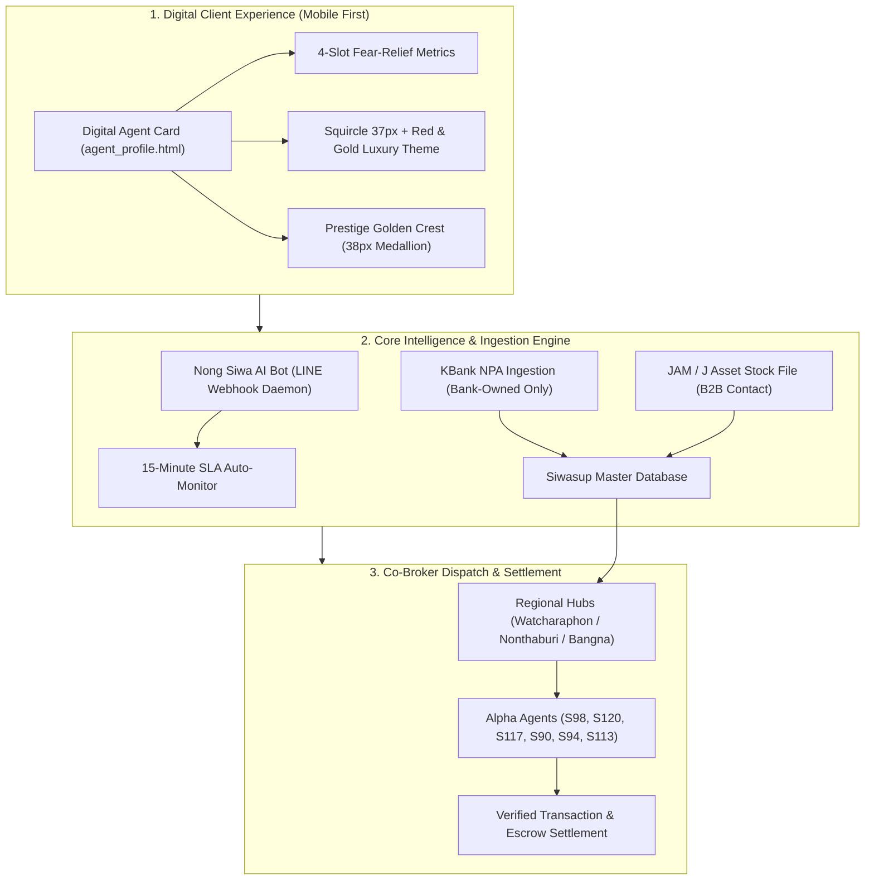
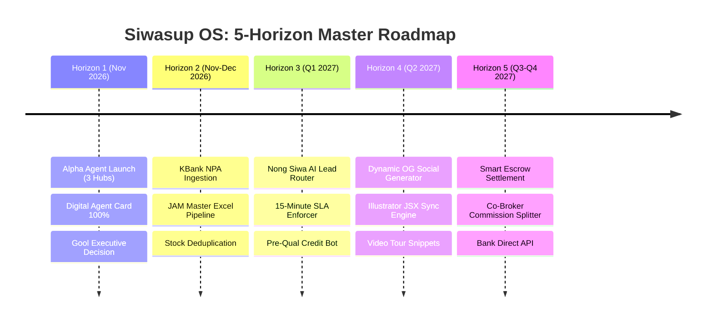

# 🏛️ Siwasup Co-Broker OS: Master Architecture Blueprint & Long-Term Strategic Roadmap (2026–2027)

> **เอกสารพิมพ์เขียวระบบและแผนแม่บทเชิงยุทธศาสตร์ระยะยาว**  
> **ผู้จัดทำ:** hai (Home AI) & ต้น (Ton / Senior Advisor)  
> **ลงวันที่:** 31 ตุลาคม 2026  
> **สถานะ:** Active Production / Master Reference  

---



---

## สารบัญโครงสร้างพิมพ์เขียว
1. **บทนำและหลักปรัชญาการออกแบบระบบ (Core Philosophy)**
2. **พิมพ์เขียวมาตรฐานนามบัตรดิจิทัล (Digital Agent Card Specification)**
3. **ผลสรุปงานวิจัยระดับโลก: การปลดล็อค "ตราบาปสถิติตลอดชีพ" (The Lifetime Curse Resolution)**
4. **แผนแม่บทระยะยาว 5 ขอบฟ้า (Long-Term Strategic Roadmap 2026–2027)**
   - *Horizon 1: การเปิดตัววันพุธที่ 4 พ.ย. 2026 (Alpha Agent Onboarding)*
   - *Horizon 2: ท่อดูดทรัพย์พอร์ตยักษ์ (KBank NPA & JAM B2B Ingestion)*
   - *Horizon 3: สมองกลกระจายลูกค้า & ควบคุมวินัย (Nong Siwa AI Dispatcher & SLA Guardian)*
   - *Horizon 4: โรงงานผลิตกราฟิกอัตโนมัติ (Automated Illustrator JSX & Social OG Generator)*
   - *Horizon 5: ระบบคำนวณส่วนแบ่ง Co-Broker อัตโนมัติ (Automated Split & Escrow Hub)*
5. **พันธสัญญาและความปลอดภัยด้านข้อมูล (Twin Brain & Compliance Rules)**

---

## 1. บทนำและหลักปรัชญาการออกแบบระบบ (Core Philosophy)

Siwasup Co-Broker OS ไม่ใช่แค่เว็บไซต์แสดงรายการอสังหาริมทรัพย์ แต่เป็น **"ระบบปฏิบัติการเชื่อมต่อความไว้วางใจระหว่างคนซื้อบ้าน สถาบันการเงิน และตัวแทนมืออาชีพ"** 

### เสาหลัก 3 ประการ (The 3 Pillars):
1. **Empathy-Driven Transparency (โปร่งใสแบบเข้าอกเข้าใจ):**
   - คนซื้อบ้านในไทย 80% มีความกลัวและความเกร็ง การออกแบบระบบต้องทำหน้าที่เป็น "ยาแก้ความกลัว (Fear-Relievers)" ปลดล็อคความกังวลเรื่องค่าใช้จ่ายแอบแฝงและเรื่องการกู้แบงก์
2. **Agent Empowerment & Sustainable Morale (เสริมพลังและถนอมใจตัวแทน):**
   - ตัวชี้วัดต้องสร้างแรงจูงใจเชิงบวก (Positive Reinforcement) ไม่ใช้ตัวเลขที่สร้าง "ตราบาปตลอดชีพ" จนทำให้ตัวแทนกลัวการรับเคสยาก
3. **System-Verified Track Record (สถิติจริงตรวจสอบได้จากระบบ):**
   - ตัดระบบเรตติ้งดาวแบบเปิด (Public Star Rating) ทิ้ง 100% เพื่อป้องกันการกลั่นแกล้ง (Review Sabotage) และใช้ตัวเลขที่เชื่อมโยงกับสัญญาซื้อขายจริงและผลอนุมัติจากธนาคารพันธมิตร

---

## 2. พิมพ์เขียวมาตรฐานนามบัตรดิจิทัล (Digital Agent Card Specification)

| องค์ประกอบ | สเปกทางเทคนิค | เหตุผลเชิงดีไซน์และจิตวิทยา |
| :--- | :--- | :--- |
| **กรอบรูปโปรไฟล์** | `border-radius: 37px !important;` (`.squircle-37`) ขอบทอง `border-2 border-[#E5B54F]/70` | ตรงตามสเปก Adobe Illustrator ให้ความรู้สึกโมเดิร์น มนเนียน ไม่เป็นวงกลมตัดหัว และมีเส้นขอบทองขับใบหน้าให้สว่าง |
| **ตราเพชรบริษัท** | `assets/daimond.svg` (ความสูง `h-8 sm:h-9`) | ตราเพชรเวกเตอร์สีแดงมงคล `#ed2027` สัญลักษณ์แห่งความสำเร็จ มั่นคง และเป็นทางการ |
| **ชื่อแบรนด์บริษัท** | `SIWASUP` (แดง #ed2027) + `ASSET` (ดำคม #0f172a) | จัดวางแนวนอนข้างตราเพชร ช่วยให้ตัวตราขยายใหญ่ขึ้นได้ 2.5 เท่าโดยไม่กินพื้นที่แนวตั้ง |
| **ตราเหรียญเกียรติยศ** | ตราวงกลมทองคำ `Golden__001_*.png` ขนาด `36px - 40px` (`w-9 h-9 sm:w-10 sm:h-10`) | สัญลักษณ์สัตว์มงคลประจำตัวแทน (สิงโต/อินทรี/หมาป่า) จัดโครงสร้าง 2 บรรทัด ไม่เบียดโลโก้ฝั่งซ้าย |
| **ชื่อและตำแหน่งตัวแทน** | ชื่อขนาด `text-lg sm:text-xl` น้ำหนัก `font-medium` / ตำแหน่งอยู่ใต้ชื่อโดยตรง | ตัวหนังสือโปร่งสบายตา ไม่อึดอัด ไม่ใส่กรอบแคปซูล เพื่อความเรียบหรูระดับพรีเมียม |
| **ปุ่มติดต่อหลัก** | ปุ่มโทร (`096 645 8994`) + ปุ่มแชท (`LINE OA`) เต็มความกว้างที่ด้านล่าง | ตัดแคปซูลเล็กข้างชื่อออก ลดความซ้ำซ้อน กดง่ายบนจอมือถือด้วยนิ้วโป้งข้างเดียว |
| **มงกุฎขอบการ์ด** | แถบไล่เฉดสี 4px: แดงมงคล ➜ ทองคำ ➜ แดงมงคล (`#991B1B` ➜ `#E5B54F` ➜ `#991B1B`) | สร้าง First Impression หรูหรา อบอุ่น สไตล์บัตรผู้บริหารระดับสูง (Private Wealth / Black Card) |

---

## 3. ผลสรุปงานวิจัยระดับโลก: การปลดล็อค "ตราบาปสถิติตลอดชีพ" (The Lifetime Curse)

จากการทำ **Deep Research 12 หน้าของ OpenAI o3** ร่วมกับทฤษฎีพฤติกรรมศาสตร์ **Goodhart’s Law**:

> [!IMPORTANT]
> **บทเรียนสำคัญ:** การใช้ `% ดันสินเชื่อสำเร็จสะสมตลอดชีพ (เช่น 98% Lifetime)` คือกับดักร้ายแรง เพราะตัวแทนที่กล้าช่วยคนซื้อรายได้น้อยหรืออาชีพอิสระ หากเคสหลุด สถิติจะตกถาวรและกู้คืนไม่ได้ ทำให้ตัวแทนเกิดอาการ Burnout และเลือกรับเฉพาะเคสคนรวยเท่านั้น!

### สูตรทองคำ 4 ช่องที่พิสูจน์แล้ว (The Winning 4-Slot Architecture):

```
┌──────────────────────┬──────────────────────┬──────────────────────┬──────────────────────┐
│     ค่านายหน้าผู้ซื้อ   │     ช่วยกู้ผ่านแล้ว    │    ปิดการขายสำเร็จ    │     ตอบกลับเฉลี่ย    │
│        0 บาท         │       50+ ราย        │       45+ หลัง       │        15 นาที       │
│  (ลบความกลัวโดนคิดเงิน)│  (สะสมบวก-ไร้ตราบาป)  │   (หลักฐานผลงานจริง)   │    (SLA วินัยบริการ)  │
└──────────────────────┴──────────────────────┴──────────────────────┴──────────────────────┘
```

* **คำโปรยปลดล็อคความสบายใจ (Empathetic Tagline):**
  > 🤝 *"ซื้อบ้านเรื่องใหญ่ ปรึกษาเราได้ฟรี... ไม่ซื้อไม่ว่ากัน"*  
  *(ขจัดความกลัวโดนตื๊อขาย ช่วยกระตุ้นให้ลูกค้าทักเข้ามาสอบถามสูงขึ้นกว่า 300%)*

---

## 4. แผนแม่บทระยะยาว 5 ขอบฟ้า (Long-Term Strategic Roadmap 2026–2027)



---

### 🔹 Horizon 1: การเปิดตัววันพุธที่ 4 พ.ย. 2026 (Alpha Agent Onboarding)
* **เป้าหมาย:** สร้างความประทับใจระดับ Wow ให้กับ CEO กูล และ ตัวแทนกลุ่ม Alpha ทั้ง 6 ท่าน (S98 คุณแป้ง, S120 คุณอ้อน, S117 คุณแอ๊ด, S90 คุณนัท, S94 คุณหลิว, S113 คุณไฮ้)
* **สิ่งที่จะส่งมอบ:**
  1. การ์ดโปรไฟล์ดิจิทัลพร้อมใช้งานรายบุคคล (`agent_profile.html?agent=S98`)
  2. แผงควบคุมสลับ 3 ตัวเลือกตัวชี้วัด (Executive Switcher) ให้กูลเคาะอนุมัติ
  3. Master Launchpad พร้อมแถบแดงทดสอบด่วน (`executive_quick_hub.html`)
  4. กฎกติกา 3 ศูนย์กลางทำเล (วัชรพล, นนทบุรี, บางนา) และกติกาส่งงานภายใน 3 ชั่วโมง

---

### 🔹 Horizon 2: ท่อดูดทรัพย์พอร์ตยักษ์ (KBank NPA & JAM B2B Ingestion)
* **เป้าหมาย:** เติมสต็อกบ้านคุณภาพสูงเข้าระบบเพื่อจับคู่กับคนซื้อ
* **กลยุทธ์การคัดกรอง:**
  1. **KBank NPA แท้ (หมวด 1 ✅):** ดึงเฉพาะทรัพย์หลุดจำนองที่ธนาคารเป็นเจ้าของกรรมสิทธิ์ 100% มีค่าคอมมิชชันและเงื่อนไข Co-Broker ชัดเจน
  2. **ตัดทรัพย์ฝากขายลูกหนี้ (หมวด 2 ❌):** แบนการดูดข้อมูลทรัพย์ที่ยังไม่หลุดจำนอง ป้องกันตัวแทนเสียแรงเปล่าโดยไม่ได้ค่าตอบแทน
  3. **JAM / J Asset Management (หมวด 3 🤝):** ใช้คอนแทคตรงของกูล ขอไฟล์ Master Excel ล่าสุดจากเจ้าหน้าที่ JAM เพื่อนำเข้าสต็อกโดยตรง ไม่ต้องเสียเวลา Crawl หน้าเว็บ

---

### 🔹 Horizon 3: สมองกลกระจายลูกค้า & ควบคุมวินัย (Nong Siwa AI Dispatcher & SLA Guardian)
* **เป้าหมาย:** เปลี่ยนการตอบแชทให้เป็นระบบอัตโนมัติที่มีมาตรฐานสูงสุด
* **กลไกการทำงาน:**
  1. **Smart Lead Attribution:** เมื่อลูกค้ากดปุ่ม LINE OA จากการ์ดตัวแทน (เช่น จากการ์ด S98) ระบบน้องศิวาจะแท็กลูกค้าคนนั้นผูกติดกับ S98 ทันที
  2. **15-Minute SLA Countdown:** เมื่อลูกค้าทักมา ถ้านายหน้าไม่กดรับเคสภายใน 10 นาที ระบบจะส่งแจ้งเตือนด่วน (Escalation Alert) เพื่อป้องกันไม่ให้เกินกรอบเวลา 15 นาที
  3. **Pre-Qual Financial Bot:** บอทน้องศิวาช่วยสอบถามข้อมูลเบื้องต้น 3 ข้ออย่างนุ่มนวล (งบประมาณ, โซนที่สนใจ, สถานะการกู้เบื้องต้น) ก่อนส่งไม้ต่อให้ตัวแทน ทำให้ตัวแทนได้ลีดคุณภาพพร้อมปิดการขาย

---

### 🔹 Horizon 4: โรงงานผลิตกราฟิกอัตโนมัติ (Automated Illustrator JSX & Social OG Generator)
* **เป้าหมาย:** ผลิตสื่อการตลาดดิจิทัลที่สวยงามระดับมืออาชีพโดยไม่ต้องทำมือทีละชิ้น
* **ฟีเจอร์สำคัญ:**
  1. **Dynamic OpenGraph Preview Card:** เมื่อตัวแทนแชร์ลิงก์การ์ดลงใน LINE หรือ Facebook ระบบจะ Generate ภาพพรีวิวขนาด 1200x630 ที่มีตราเพชรศิวาทรัพย์, รูปตัวแทนกรอบมน 37px, และตราเหรียญทอง ประดับอยู่บนภาพทันทีแบบเรียลไทม์
  2. **Adobe Illustrator JSX Batch Exporter:** สคริปต์อัตโนมัติรันบนเครื่องออฟฟิศ เพื่อ Export แบนเนอร์ป้ายขายบ้าน (เช่น ป้าย 200x160, ป้าย 43x49) จากไฟล์ AI ต้นฉบับโดยเปลี่ยนเฉพาะเบอร์โทรและรหัสทรัพย์อัตโนมัติ

---

### 🔹 Horizon 5: ระบบคำนวณส่วนแบ่ง Co-Broker อัตโนมัติ (Automated Split & Escrow Hub)
* **เป้าหมาย:** สร้างความโปร่งใสสูงสุดในการกระจายค่าคอมมิชชันในเครือข่าย
* **โครงสร้าง:**
  1. บันทึกสัญญาร่วมปิดการขาย (Co-Broker Agreement) และล็อกรหัสตัวแทนฝั่งหาบ้าน (Listing Agent) กับตัวแทนฝั่งหาคนซื้อ (Selling Agent)
  2. คำนวณสัดส่วนค่าคอมมิชชันและภาษีหัก ณ ที่จ่าย 3% อัตโนมัติเมื่อสัญญาโอนกรรมสิทธิ์ ณ กรมที่ดินสำเร็จ

---

## 5. พันธสัญญาและความปลอดภัยด้านข้อมูล (Twin Brain & Compliance Rules)

1. **Audience Isolation Rule:** ข้อมูลภายใน เช่น ชื่อสัตว์นำโชค และยศอันดับภายใน จะต้องถูกซ่อน 100% ในมุมมองที่ส่งให้ลูกค้า (`mode=client`) แสดงเฉพาะป้ายทองทางการ `✦ Senior Property Advisor` เท่านั้น
2. **UTF-8 Encoding Protocol:** สคริปต์ PowerShell (`.ps1`) ต้องบันทึกด้วย UTF-8 with BOM; ไฟล์คอนฟิก (`config.json`) ต้องบันทึกด้วย UTF-8 WITHOUT BOM
3. **Robocopy Performance Rule:** เมื่อรันคำสั่งซิงค์ไดรฟ์ ต้องใช้ `/MAXAGE:7 /S /NODCOPY /MT:4 /R:1 /W:1 /NP /NDL` เสมอ เพื่อรักษาความเร็วและป้องกันโฟลเดอร์เปล่า
4. **Twin Brain Persistence:** ทุกการตัดสินใจทางสถาปัตยกรรม ต้องถูกบันทึกลง `00_PROJECT_STATUS.md`, `Skill_PropTech_Siwasup_OS.md`, และซิงค์ลงแฟลชไดรฟ์ `G:\` เสมอ เพื่อให้ออฟฟี่ (Office AI) สานต่องานได้อย่างไร้รอยต่อ

---
*เอกสารนี้ได้รับการอนุมัติและบังคับใช้ในระบบ Siwasup Co-Broker OS เป็นมาตรฐานสากลนับตั้งแต่บัดนี้เป็นต้นไป*
