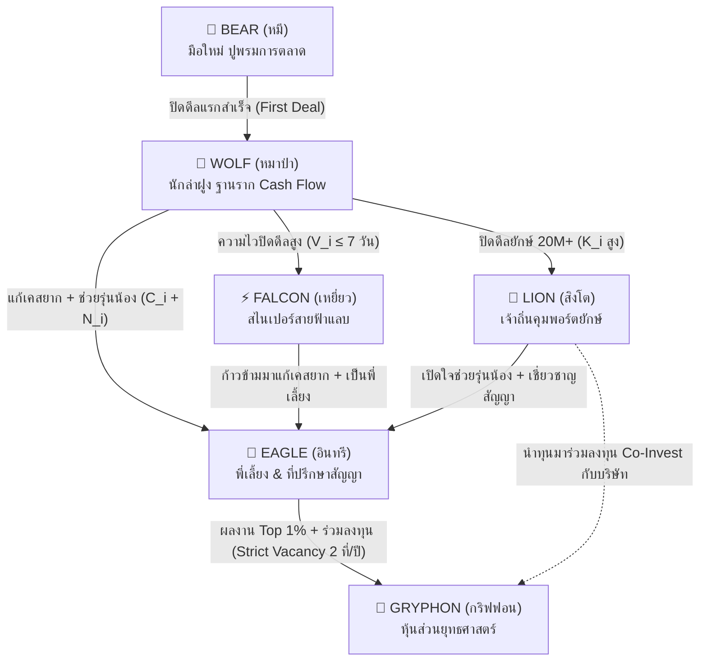

# 🦅🦁 Siwasup 6-Tier Sovereign Archetype Ecosystem & Human Dynamics
**หมวดหมู่:** `Work_Brain/02_Projects` | **โปรเจกต์:** Siwasup Co-Broker OS  
**ผู้บันทึก:** hai (Home AI) คู่คิดพี่ต้น (Ton / NASSTY)  
**วันที่บันทึก:** 26 ตุลาคม 2569 (02:55 น.)  
**เอกสารอ้างอิง:** Whitepaper 16 หน้า (*Designing a 6-Tier Archetype Ecosystem for Siwasup OS*)  

---

## 🌟 1. ปรัชญาการออกแบบระบบตามธรรมชาติมนุษย์ (Human Dynamics Philosophy)

ระบบนิเวศตัวแทน 6 ตระกูล (Sovereign Archetypes) ของ Siwasup OS ไม่ได้ถูกสร้างขึ้นมาเพียงเพื่อเป็นตัวเลข KPI แบนๆ 2 มิติ แต่ถูกออกแบบจาก **"ความเข้าใจในจิตวิทยาและพฤติกรรมจริงของเอเจนท์อสังหาริมทรัพย์"**:

1. **👑 อินทรี (Eagle) = "บารมีและที่พึ่งที่แท้จริงของรุ่นน้อง"**
   - ในระบบทั่วไป คนที่ขายเก่งแต่เห็นแก่ตัว หรือแอบฮุบเคสรุ่นน้องก็สามารถขึ้นเป็น Top ได้ แต่รุ่นน้องไม่เคารพ
   - ใน Siwasup OS คนที่จะติดตราอินทรีได้ **ต้องผ่านการเป็น "พี่เลี้ยง Co-Closing" ช่วยรุ่นน้องหมาป่าปิดเคส + ซื่อสัตย์เรื่องกุญแจพี่ลิลลี่ ($T_i \ge 90$) + แก้เคสยาก ($C_i \ge 1.5$)** ดังนั้น ใครได้เป็นอินทรี **รุ่นน้องจะยกมือไหว้และนับถือจากหัวใจ 100%**
2. **🦁 สิงโต (Lion) = "ราชาลุยเดี่ยว ไม่ชอบสุงสิง แต่ผลงานระดับปีศาจ (Lone Alpha)"**
   - สิงโตจะไม่สนใจงานจิปาถะ ไม่ทำกิจกรรม ไม่เข้าอบรม ($A_i$ ต่ำ) เพราะเวลาของเขามีค่ากับการปิดดีลเศรษฐี 20M - 100M+
   - **ระบบให้เกียรติเส้นทางของเขา:** ไม่บังคับให้สิงโตต้องมาทำกิจกรรมหรือเป็นหัวหน้าทีม มอบสถานะ "LION เจ้าถิ่น" ให้เขาครองพอร์ตใหญ่ไปอย่างสมศักดิ์ศรี
   - **แต่เปิดประตูไว้เสมอ:** หากวันใดสิงโตอยากปรับตัวเพื่อเป็นอะไรที่ยิ่งใหญ่กว่าเดิม เขาสามารถผันตัวมาช่วยรุ่นน้องเพื่อเป็น **อินทรี** หรือนำเงินมาร่วมทุนเพื่อขึ้นเป็น **กริฟฟอน**
3. **🐺 หมาป่า (Wolf) = "กองทัพนักล่าฐานราก (Backbone of Cash Flow)"**
   - หมาป่าคือกระดูกสันหลังของบริษัท (สัดส่วน 50-60%) ออกล่าเป็นฝูง ทรัพย์ 2-5 ล้าน คอนโด ทาวน์โฮม ช่วยกันส่งต่อ Lead ข้ามโซน สร้างสภาพคล่องหล่อเลี้ยงบริษัททุกวัน
4. **⚡ เหยี่ยว (Falcon) = "สไนเปอร์สายฟ้าแลบ (Speed Closer)"**
   - คล่องตัวสูง ปิดเคสไวภายใน 7 วัน หมุนเงินเร็ว เป็นตัวเร่ง Cash Velocity ให้กับเน็ตเวิร์ก
5. **🐻 หมี (Bear) = "ผู้สร้างรากฐาน (Groundwork Specialist)"**
   - ตัวแทนใหม่ ขยันปักป้าย สำรวจพื้นที่ สะสมสต็อกทรัพย์รอวันปล่อยของ
6. **🔱 กริฟฟิน (Gryphon) = "หุ้นส่วนยุทธศาสตร์ (Sovereign Partner)"**
   - บัลลังก์สูงสุดผสมผสานระหว่างสติปัญญาของอินทรีและพลังทุนของสิงโต (จำกัด 2 ที่นั่ง/ปี ผ่านมติบอร์ด)

---

## 📈 2. แผนผังและเกณฑ์การเลื่อนขั้น (Promotion Criteria Matrix)

---

## 📊 3. ตารางชี้วัด 7 มิติพฤติกรรม (The 7-Dimension Feature Vector)

| มิติ | ชื่อชี้วัด | พฤติกรรมในโลกจริง | แหล่งข้อมูล (Zero-Overhead Telemetry) | ตระกูลเป้าหมาย |
| :--- | :--- | :--- | :--- | :--- |
| **$A_i$** | Activity Index | ปักป้ายไวนิล, ถ่ายรูปทรัพย์, แชร์สื่อโซเชียล | นับยอดดาวน์โหลด Artwork, Check-in, ยอดคลิก Smart Link | 🐻 หมี (Bear) |
| **$P_i$** | Performance | ยอดขายสะสม, เงินมัดจำ, โอนกรรมสิทธิ์ | บันทึกสลิปมัดจำ + คุณบัวกด Approve 1-Click ใน LINE OA | 🐺 หมาป่า (Wolf) |
| **$V_i$** | Deal Velocity | ความเร็วปิดดีลเฉลี่ย $\le 7$ วัน | ระบบจับ Timestamp อัตโนมัติ: จากรับ Lead ถึงเซ็นสัญญา | ⚡ เหยี่ยว (Falcon) |
| **$K_i$** | Ticket Kurtosis | ปิดทรัพย์ไซส์ใหญ่ Super Luxury 20M–100M+ | คำนวณค่า Kurtosis จากมูลค่าธุรกรรมจริงในใบเสร็จ | 🦁 สิงโต (Lion) |
| **$C_i$** | Asset Complexity | เคสซับซ้อน (NPA แบงก์, มรดก, ภาษีโอน) | ดึงค่าความยาก (1.5–2.0x) อัตโนมัติจากฐานข้อมูล Bank NPA Master | 👑 อินทรี (Eagle) |
| **$T_i$** | Key Custody Trust | วินัยเบิก-คืนกุญแจตรงเวลา ($\le 2$ ชม.) ไม่ทำหาย | สแกน QR ตอนเบิก-คืนที่โต๊ะพี่ลิลลี่ บันทึก Timestamp 2 วินาที | 🛡️ ด่านคัดกรอง Eagle & Gryphon |
| **$N_i$** | Network Centrality | โค้ชชิ่งช่วยรุ่นน้อง Co-Closing + ขยายสายงาน | บันทึก Co-Agent ในระบบปิดการขาย + รหัสผู้แนะนำตัวแทน | 🔱 กริฟฟอน (Gryphon) |

---

## 💡 4. กลยุทธ์การเปิดตัวและการคุมสมดุลพีระมิด (Rollout & Quota Balancing)

### 4.1 หน้าบ้าน vs หลังบ้าน
* **หน้าบ้าน (Presentation & Identity):** **"เปิดตูมเดียว 6 ตัวทันที"** เพื่อโชว์ภาพใหญ่ บันไดอาชีพ และความหรูหราระดับสถาบันการเงิน ป้องกันปัญหาจิตวิทยา "โดนลดขั้นย้อนหลัง" (เช่น ใครขึ้น Eagle ไปแล้ว พอเปิด Falcon ทีหลังจะรู้สึกเหมือนโดนลดขั้น)
* **หลังบ้าน (Data & Engine):** **"รัน 2 จังหวะแบบ Zero-Overhead"**
  * *จังหวะที่ 1 (Day 1):* 125 ตัวแทนเดิมจัดเข้า 4 กลุ่มรากฐาน (Bear, Wolf, Lion, Eagle) ทันทีจากแต้ม Google Sheets เดิม
  * *จังหวะที่ 2 (Phase 2):* เปิดระบบ Telemetry ความไว ($V_i$) และกุญแจพี่ลิลลี่ ($T_i$) ดึงตัวแทนหมาป่าที่มีประวัติปิดไวสถาปนาเป็น **เหยี่ยว** ชุดแรกอย่างสมภาคภูมิ

### 4.2 การคุมโควต้าป้องกันเพดานตัน (Anti-Congestion)
* **ดองหมาป่าไว้ได้ (Wolf 50–60%):** เป็นกองกำลังหลักในการสร้าง Cash Flow รายวัน
* **ดองสิงโตไว้ได้ (Lion 10–15%):** ล็อกด้วยมูลค่าทรัพย์ 20M+ และโควต้าคุมโซน ไม่ให้ทับซ้อนกัน
* **ปล่อยอินทรีได้จำกัด (Eagle 5–8%):** กรองด้วย $T_i$ (กุญแจพี่ลิลลี่) และเคสซับซ้อน $C_i$ ทำให้อินทรีเป็นตำแหน่งทรงคุณค่า
* **กริฟฟอน (Gryphon 1-2 ที่นั่ง):** ควบคุมสูงสุดด้วยมติบอร์ดบริหาร (Strict Vacancy)
