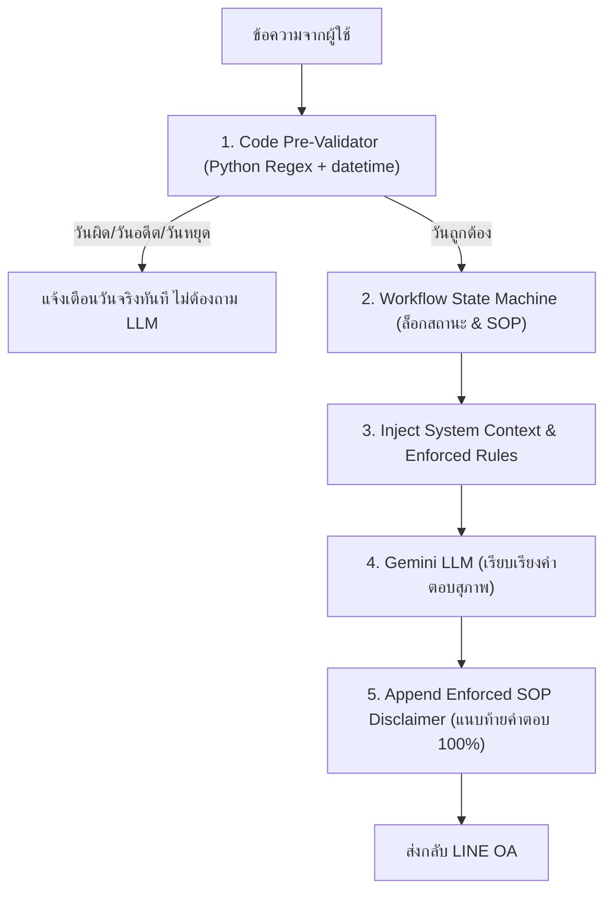

# Skill: Siwasup Tech Pipeline & Cloud Architecture (ระบบวิศวกรรมข้อมูล คลาวด์ และบอท)
`[Triggers: Multi-Bank Scraping, KTB, ALPHA, PAMCO, BAM, JAM, GHB, Ingestion, Cloudflare R2, น้องศิวา, LINE Webhook, Hybrid State Machine, Crawler Pipeline]`

---

## 🖥️ 4. Tools & Interface Suite (ระบบเครื่องมือและหน้าบ้าน)

1. **`property_curator.html` (Legacy Property Curator):**
   - เครื่องมือคัดกรองทรัพย์ 119 แปลงเดิม พร้อมระบบ Bookmark หัวใจ ❤️, กรองตามประเภทและสถานะ, Auto-save ลง `localStorage`, Export JSON/CSV
2. **`npa_spotlight_curator.html` (High-Volume NPA Spotlight Curator):**
   - เครื่องมือคัดเลือกทรัพย์ NPA จำนวนมหาศาลจากพอร์ตธนาคาร
   - มี 2 โหมด: **Dense Grid Mode** และ **Speed Deck Keyboard Mode** (`[1]` Hero, `[2]` Hot Deal, `[3]` Renovation, `[Space]` Pass, `[←/→]` เลื่อน)
   - แผง Live Preview เลื่อนดูข้อมูลเต็มจากขวา พร้อม Export เพื่อนำขึ้นหน้าแรก
3. **`welcome_landing.html` (Grand Welcome & Announcement Portal):**
   - หน้าต้อนรับหรูหราก่อนเข้าสู่แคตาล็อกบ้าน รองรับสถาปัตยกรรมสีทองซาติน (`#C2A460`) และน้ำตาลทองหรูหรา
   - **Logo:** โลโก้เวกเตอร์ SVG ศิวาทรัพย์ **สีแดงเข้มมรดก (`#990000`)** เด่นสง่างาม
   - **Section 8 (Announcement):** ประชุมประจำงวด + หอเกียรติยศ TOP SALES ประจำเดือน
   - **Section 10 (Client Knowledge & SEO):** คอนเทนต์ความรู้อสังหาฯ เจาะกลุ่มค้นหา + หมวด **[HOT NEWS]**
   - **Section 11 (CSR & Activity Mosaic):** แกลเลอรีภาพกิจกรรมบริษัทและผลงานเพื่อสังคม
4. **`admin_dashboard.html` (Central Back-Office Dashboard):**
   - หน้าแดชบอร์ดหลักของแอดมินหลังบ้าน พร้อมระบบ Role-Based Login (Super Admin, Sales & Ops, Content Editor)
   - **Section 18 (Monthly GMV & Transfers):** สรุปยอดจอง, จำนวนบ้านปิดการขาย, และยอดโอนกรรมสิทธิ์รวม
   - **Section 17 (Property Traffic & Click Reports):** ตารางสถิติผู้เข้าชมและจำนวนคลิกดูทรัพย์แต่ละรายการ พร้อมส่งออก CSV
   - **Quick Tools Suite:** ปุ่มลัดเปิด Curator ทั้ง 2 ตัว และระบบจัดการคอนเทนต์บทความ
5. **`index.html` (Catalog Sticky Header & Offer Engine):**
   - ขยายโลโก้เวกเตอร์แถบบนให้เด่น สง่างาม ไม่ดูเป็น Tool เกินไป (`h-9` บนมือถือ, `h-12` ถึง `h-15` บนแท็บเล็ต/เดสก์ท็อป)
   - ติดตั้งตัวคำนวณและชิปปรับราคาด่วน (0%, -10%, -20%, -30%, -50%) ใน Modal ยื่นเสนอราคา

---

---

## ☁️ 5. Cloud Infrastructure & Asset Storage (Cloudflare R2 & Domain Setup)
> **จดทะเบียนและติดตั้งสำเร็จ:** 27 ตุลาคม 2569 (22:15 น.)

- **Official Domain:** `siwasup.com`
  - **Registrar:** Cloudflare Registrar (ต้นทุน $10.46/ปี รวม ICANN Fee ไม่มีบวกกำไร)
  - **Status:** Active (หมดอายุ 27 ตุลาคม 2570 / เปิด Auto-Renew อัตโนมัติ)
  - **WHOIS Privacy:** Redacted / Private 100% ฟรีตลอดชีพ
- **Account Credentials & Identity:**
  - **Google Account กลาง:** `siwasupagent@gmail.com` (เปิด 2FA + Authenticator ผูกมือถือพี่ต้น & บัว)
  - **Cloudflare Account ID:** `b2f44870ea14a9a5114dfb6163b48c`
- **R2 Object Storage (คลังเก็บภาพบ้าน NPA 10,800+ แปลง):**
  - **Bucket Name:** `siwasup-npa-assets`
  - **Public CDN Custom Domain:** `assets.siwasup.com` (ผูก CNAME ตรงกับ Bucket มี SSL ในตัว ฟรี Bandwidth Egress ตลอดชีพ)
  - **S3 API Endpoint URL:** `https://b2f4f44870ea14a9a5114dfb6163b48c.r2.cloudflarestorage.com`
- **R2 API Token (สำหรับบอท/สคริปต์ดูดรูป Homerun API):**
  - **Token Name:** `siwasup-npa-uploader`
  - **Permissions:** Object Read & Write (All buckets on account)
  - **Credentials:** Managed via secure `.env` and Render Environment Secrets (R2_TOKEN_SECRET / R2_ACCESS_KEY / R2_SECRET_KEY)
  - **Exact S3 Endpoint URL:** `https://b2f4f44870ea14a9a5114dfb6163b48c.r2.cloudflarestorage.com`

---

---

## ⚡ 7. Automated Overnight R2 Ingestion Engine (เครื่องจักรดูดภาพอภิมหาทรัพย์ข้ามคืน)
> **เริ่มปฏิบัติการ:** คืนวันที่ 27-28 ตุลาคม 2569

### 🏗️ Technical Architecture:
1. **Zero-Disk RAM Streaming:**
   - สคริปต์ `scripts/overnight_r2_crawler.py` ดึงข้อมูลภาพจาก Supabase/Homerun พักใน RAM Buffer ชั่วคราว แล้วยิงตรงขึ้น Cloudflare R2 (`assets.siwasup.com`) ผ่าน **Pure Python AWS SigV4 HMAC-SHA256 PUT**
   - **ไม่เปลืองพื้นที่ฮาร์ดดิสก์ในคอม และไม่แตะพื้นที่ในแฟลชไดรฟ์ G:\ แม้แต่ไบต์เดียว!**
2. **Resilience & Checkpoint State:**
   - สถานะความคืบหน้าบันทึกลง `data/r2_images_sync_state.json` ทุกๆ 20 แปลง
   - แผนที่ URL จัดเก็บลง `data/r2_assets_manifest.json` เพื่อใช้เป็นฐานข้อมูลลิงก์ภาพ
   - Idempotent 100%: หากเน็ตหลุด ไฟดับ หรือเปิดโปรแกรมใหม่ บอทจะข้ามแปลงที่เสร็จแล้วไปทำต่อทันที
3. **Stealth Rate-Limiting & Pipeline:**
   - หน่วงเวลา 0.15s ระหว่างภาพ และ 0.25s ระหว่างแปลง ความเร็วเสถียรอยู่ที่ **~8.5 แปลง/นาที (~42 รูปภาพ/นาที)**
   - ลำดับคิวดูดภาพ: **SCB (4,207 แปลง) ➔ SAM (5,100 แปลง) ➔ TTB (1,365 แปลง)** รวมทั้งสิ้น 10,672 แปลง
4. **Bitwise 1:1 Bank Verification:**
   - ผลการทดสอบ SHA-256 Hash ระหว่างเซิร์ฟเวอร์แท้ของ SCB (`asset.home.scb`) กับถัง R2 ศิวาทรัพย์ ได้ผลลัพธ์ **ตรงกัน 100% ทุกบิต (c39043788ba4eb26bec1b5bc7a6b3cadc4291c2e216e8ae59e69c1f6973ad122)** ยืนยันความคมชัดเทียบเท่าต้นฉบับธนาคารสมบูรณ์แบบ

---

---

## 📊 8. Real-time Visual Ingestion Dashboard (แดชบอร์ดเกจ 3 กษัตริย์ถอดแบบจาก Illustrator)
- **Design Origin:** ถอดแบบโครงสร้าง 1:1 จากอาร์ตบอร์ด Illustrator ของคุณต้น (`E:\TON\#Siwasub\images\Volumn Info.ai`)
  - **3D Embossed Dials:** มิติมูนูน Bevel แผ่นวงกลมสีเงิน-ขาว พร้อมเงามือจับสไตล์ Digital Luxury
  - **3 Bank Gauges:** SAM (วงแหวนแดง `#C8232C`), TTB (วงแหวนน้ำเงิน `#0066B3`), SCB (วงแหวนม่วง `#4E2A84`)
- **Telemetry & Monitoring:**
  - สปีดการประมวลผล Real-time, ตัวนับถอยหลังเวลาคาดว่าจะเสร็จ (ETA), ขนาดความจุที่ใช้จริงบน Cloudflare R2, และ Live Feed การ์ดแสดงผล 4 ทรัพย์ล่าสุดที่เพิ่งสอยเสร็จ
- **Access Endpoints:**
  - **Local PC:** `http://localhost:8080/crawler_dashboard.html`
  - **Mobile Bedside (Wi-Fi บ้าน):** `http://192.168.1.62:8080/crawler_dashboard.html`
  - **Server Worker:** รันเบื้องหลังด้วย `scripts/dashboard_live_server.py` อัปเดตข้อมูลทุก 2-3 วินาทีอัตโนมัติ

---

---

## 🌐 9. Live Cloud Sync & Global Mobile Dashboard (`assets.siwasup.com/dashboard.html`)
> **ติดตั้งและเปิดใช้งานสำเร็จ:** 28 ตุลาคม 2569 (06:30 น.)

- **Public Live Monitoring URL:**
  - 🔗 **`https://assets.siwasup.com/dashboard.html`** (หรือ `crawler_dashboard.html`)
- **Zero-CORS & Real-time Cloud Pipeline:**
  - `scripts/dashboard_live_server.py` ตรวจวัดความคืบหน้าการดูดภาพ และอัปโหลด `crawler_live_state.js` ขึ้น Cloudflare R2 โดยตรงทุกๆ 10 วินาที
  - ติดตั้งกลไก **Cache-Busting (`?t=${Date.now()}`)** ทำให้บราวเซอร์ทุกเครื่อง (มือถือ 4G, แท็บเล็ต, คอมฯ ที่ออฟฟิศ) ดึงสถานะสดใหม่ได้ตลอดเวลา ไม่ติดแคช CDN
  - รองรับการเปิดดูจากทุกที่ทั่วโลก ทำให้พี่ต้น, กูล และบัว สามารถติดตามสถานะสดของพอร์ตได้ทันทีโดยไม่ต้องเชื่อมต่อวงแลนบ้าน

---

---

## 🤖 16. LINE OA AI Webhook ("น้องศิวา" v2), Live Chat Monitor & Main Web Sync
> **อัปเดตล่าสุด:** 31 ตุลาคม 2569 (02:30 น.)

### 💬 1. LINE OA Bot ("น้องศิวา" `@813nyyia`) & Token-Saving Chat Monitor:
- **สคริปต์หลัก:**
  - `scripts/line_gemini_webhook.py` (v2): รันเซิร์ฟเวอร์พอร์ต `5005` ใช้โมเดล `gemini-2.5-flash`
  - `scripts/start_line_bot_daemon.py` & `START_LINE_BOT.bat`: รัน Webhook + Cloudflared Tunnel + อัปเดต LINE Webhook Endpoint อัตโนมัติ + ซิงก์ขึ้น R2
- **ความสามารถ v2 (แก้บั๊กขายเกาะลันตา 245 ล้านแล้ว):**
  - โหลดทรัพย์ศิวาทรัพย์ทั้งหมด (`all_curation_properties.json` + `siwasup_all_properties.json` = 1,501 รายการ) + ทรัพย์ NPA 15,117 รายการเข้า RAM
  - ค้นหารหัสทรัพย์ 7 หลักของศิวาทรัพย์ได้แม่นยำ (เช่น `#1090965 ทาวน์โฮม ซิกเนเจอร์ รามอินทรา 109 ราคา 3.89 ล้านบาท`) โดยไม่โดนตีความเป็นงบประมาณ
  - ตัดคำกริยา `"เปิดบ้าน / ชมบ้าน / ดูบ้าน"` ออกจากตัวค้นหาประเภทบ้าน และห้ามแนบทรัพย์ขายพ่วงเมื่อตัวแทนถามเรื่องขั้นตอนเปิดบ้านหรือกฎจองคิว
  - จดจำประวัติการคุยรายบุคคล (`USER_CHAT_HISTORY[user_id]`) ตอบต่อเนื่องได้โดยไม่ลืมรหัสทรัพย์หรือชื่อลูกค้า (เช่น คุณองอาจ)
- **กฎประหยัด Token เวลาตรวจแชท LINE OA:**
  - **ห้ามใช้การอ่านรูปแคปหน้าจอแชท!** ให้เปิดอ่านไฟล์ข้อความโดยตรงจาก `C:\Users\ITss-Advice\Documents\GitHub\siwasup-cobroker-os\data\line_chat_logs.json` หรือดูผ่านหน้าเว็บ **`https://assets.siwasup.com/line_chat_monitor.html`** ซึ่งซิงก์ข้อมูลทุกข้อความแบบเรียลไทม์ ไม่เปลือง Vision Token

### 🌐 2. Unified Main Website Catalog (`index.html` & `catalog.html` — 980 รายการ):
- **สคริปต์ซิงก์:** `scripts/sync_main_web_all_3_tasks.py`, `scripts/patch_modals_and_index_live.py`, `scripts/patch_index_and_catalog_live.py`, `scripts/remove_bam_filter.py`
- **คลังข้อมูลหน้าเว็บหลัก (`siwasup_all_properties.js`):** รวม **980 รายการ** ประกอบด้วย:
  - **ทรัพย์ศิวาทรัพย์ (`Siwasup`):** 280 รายการ (ชูโรง 43 รายการที่บัวคัดแล้ว ติดป้ายสีเขียว `✓ บัวคัดแล้ว` ไว้บนสุด ตามด้วยทรัพย์พร้อมขายจริง และรายการ Sold Out ไว้ท้ายสุดเพื่อโชว์ Track Record)
  - **ทรัพย์ธนาคาร NPA (700 รายการคัดเกรด A):** `SAM` (200) + `SCB` (200) + `GSB` (150) + `TTB` (150) *(ถอดตัวกรอง `BAM` ออกจากหน้าเว็บแล้วตามคำสั่งพี่ต้น)*
- **Alpha Agent Roster (`siwasup_agents.js`):**
  - ล้างข้อมูลเลขบัตรประชาชน 13 หลักออก 100% (`idCard=0` ทั้งในไฟล์และบน Cloudflare R2) และปรับ `deploy_safe.py` ให้ตรวจจับเฉพาะเลขบัตรประชาชนจริงตามสูตร Checksum 13 หลักของกรมการปกครอง (ไม่บล็อกลิงก์รูปภาพที่มี Timestamp 13 หลัก)
  - ติดตั้งตราสัญลักษณ์ `⭐ Alpha Agent` สำหรับ 20 ขุนพลของกูลในหน้า Leaderboard

---

---

## 🏛️ 17. สถาปัตยกรรม Enterprise Bot: ทางลัดและกฎเหล็กการคุม Workflow & Date (Hybrid State Machine)
> **บันทึกองค์ความรู้สำคัญ:** 31 ตุลาคม 2569 (03:20 น.)  
> **กรณีศึกษาจริง:** การทดสอบแชทจริงกับพี่ต้นบน LINE OA "น้องศิวา" v2 (`line_chat_monitor.html`)

### ⚠️ 1. ปัญหาและข้อจำกัดของ "Pure Prompting / รุมเทรน LLM":
- **ความเชื่อที่ผิด:** คิดว่าเมื่อบอทหลุดขั้นตอน ให้เขียน Prompt กำชับเพิ่มไปเรื่อยๆ
- **ความจริงทางเทคนิค (Probabilistic Nature):** LLM ทำงานด้วยการคาดเดาคำตามความน่าจะเป็น เมื่อผู้ใช้คุยต้อนหรือส่งข้อความนำทาง บอทมีแนวโน้มจะ "เออออตามน้ำ (Sycophancy / Hallucination)" สูงมาก:
  1. **เรื่องปฏิทิน (Date Parroting):** เมื่อผู้ใช้บอก *"วันเสาร์ที่ 6 พ.ย. 2569"* บอทจะยอมรับทันที ทั้งที่ความจริงวันที่ 6 เป็นวันศุกร์ (LLM ไม่มีชิปปฏิทินจริงในสมอง ต้องรอให้คนทักท้วงถึงจะยอมรับว่าผิด)
  2. **เรื่องขั้นตอน SOP หลุด (Premature Promise):** บอทรีบรับปากว่า *"ล็อกคิวเรียบร้อย แจ้งนัดลูกค้าได้เลย"* ซึ่งผิด SOP ร้ายแรง เพราะบ้านธนาคาร/Co-Broker ต้องผ่านขั้นตอน **"รอพี่ลิลลี่เบิกกุญแจและคอนเฟิร์มจากแบงก์ (Bank SLA 1-3 วัน)"** ก่อนเสมอ
  3. **เรื่องวัตถุประสงค์ (Intent Drift):** ผู้ใช้แจ้งว่าขอเข้าถ่ายคอนเทนต์ แต่รอบต่อมาบอทกลับเข้าใจว่าเป็นนัดลูกค้า

### 🚀 2. "ทางลัดที่แท้จริง" (The Permanent Solution: Hybrid Architecture):
**หลักการสากล:** **"Code คุมกฎเหล็ก & ปฏิทิน (Deterministic) + LLM เป็นเพียงส่วนต่อประสานภาษา (Natural Language Interface)"**

### 🛡️ 3. เสาหลักพิมพ์เขียว 3 ชั้น (The 3-Layer Blueprint):

#### ชั้นที่ 1: Date & Calendar Guard (ดักจับและตรวจสอบปฏิทินจริง 100% ด้วยโค้ด)
- **เครื่องมือ:** ดักจับวันที่ภาษาไทยด้วย Regex (เช่น `(\d{1,2})\s*(ม\.ค\.|ก\.พ\.|มี\.ค\.|เม\.ย\.|พ\.ค\.|มิ\.ย\.|ก\.ค\.|ส\.ค\.|ก\.ย\.|ต\.ค\.|พ\.ย\.|ธ\.ค\.|พฤศจิกายน)\s*(\d{2,4})?`)
- **การแปลงปี:** แปลง พ.ศ. 2569 ➔ ค.ศ. 2026
- **ตรวจสอบวันในสัปดาห์:** รัน `target_date.weekday()` 
  - ถ้าผู้ใช้ระบุชื่อวันไม่ตรง (เช่น บอกวันเสาร์ แต่คำนวณได้วันศุกร์) ➔ โค้ดจะส่งข้อความสะกิดเตือนทันที:
    > *"วันที่ 6 พฤศจิกายน 2569 ตรงกับวันศุกร์ครับ ไม่ใช่วันเสาร์ คุณพี่ต้องการนัดวันศุกร์ที่ 6 หรือวันเสาร์ที่ 7 ดีครับ"*
- **ตรวจสอบวันหยุด/วันทำการแบงก์:** หากระบุวันอาทิตย์ ต้องเข้าแทร็ก Smart Keybox OTP ทันที

#### ชั้นที่ 2: Hard-Coded SOP State Machine (ล็อกสเต็ปกุญแจ 4 สเต็ป)
- **State 1: INQUIRY (สอบถามทรัพย์/ทำเล)** ➔ จำสเปกลง `USER_SEARCH_CONTEXT` (ศิริราช, บ้านเดี่ยว, ไม่อั้น)
- **State 2: VIEWING_REQUEST (แจ้งความประสงค์เปิดบ้าน)** ➔ แยกวัตถุประสงค์ทันที:
  - `A: ทำคอนเทนต์ / รีวิวบ้าน` (ใช้สิทธิ์ตัวแทน)
  - `B: พาลูกค้าเข้าชมจริง` (ต้องมีชื่อลูกค้า + เบอร์โทร + วันนัดหมาย)
- **State 3: PENDING_BANK_CONFIRMATION (รอคอนเฟิร์มกุญแจ - จุดตายที่ห้ามข้าม!)**
  - **กฎเหล็กระบบ:** **ห้ามบอทบอกว่าแจ้งนัดลูกค้าได้ทันทีเด็ดขาด**
  - ข้อความตอบกลับจะต้องแนบสถานะคิวว่า **"รอพี่ลิลลี่ตรวจสอบกุญแจกับธนาคาร (SLA 1-2 วันทำการ)"** เสมอ
- **State 4: KEY_READY_OTP_DISPATCHED (กุญแจพร้อม / แจ้ง OTP สำเร็จ)** ➔ ถึงจะสามารถยืนยันนัดกับลูกค้าได้

#### ชั้นที่ 3: Automated Swarm Testing (เทสอัตโนมัติ ไม่ต้องพิมพ์มือ)
- ใช้สคริปต์ Python จำลองส่งชุดทดสอบ 30 สถานการณ์หลุมพราง (Trap Scenarios) เช่น:
  - ทดสอบระบุวันผิด (บอกเสาร์แต่เป็นศุกร์)
  - ทดสอบขอนัดลูกค้ากระชั้นชิดใน 2 ชั่วโมง
  - ทดสอบขอกุญแจวันหยุดราชการ
  - ทดสอบแกล้งถามว่านัดลูกค้าได้เลยไหม
- สคริปต์จะยิงเข้า Local Webhook และตรวจประเมินผล Assertion (PASS / FAIL) ออกมาเป็นตารางสรุปใน 15 วินาที โดยไม่ต้องพึ่งพาการทดสอบด้วยมือ

---

---

## 🖼️ 10. Multi-Bank NPA Crawler Pipeline, Image Carousel, Lightbox & Security Masking (KTB, ALPHA, PAMCO, SAM)
`[Triggers: KTB, ALPHA, PAMCO, SAM, Image Slider, Carousel, Lightbox, Security Masking, Bank Disintermediation, Cloudflare R2, Dual-Mode Sync]`

### 1. โครงสร้างการดูดและคัดกรองทรัพย์ข้ามสถาบัน (Multi-Bank Scraping Pipeline)
- **สเกลข้อมูล:** ดูดทรัพย์ NPA ครอบคลุมทั้งประเทศ แต่ทำการคัดกรองและเปิดแสดงผลบนระบบ Co-Broker เฉพาะ **กทม. และปริมณฑล 6 จังหวัด** (กทม., นนทบุรี, ปทุมธานี, สมุทรปราการ, สมุทรสาคร, นครปฐม) ตามที่ปรึกษาคุณกูลและคุณต้นเห็นชอบ
- **ยอดทรัพย์ปัจจุบัน:** รวมทั้งสิ้น 4,049 ทรัพย์ (KTB 469 ทรัพย์, ALPHA 419 ทรัพย์, PAMCO/SAM/SCB/GSB/TTB รวม ~3,161 ทรัพย์)
- **Master Data แยกส่วน:** สำรองทรัพย์ต่างจังหวัดทั่วประเทศไว้ใน `data/ktb_property_master.json` และ `data/alpha_property_master.json` เตรียมไว้สำหรับเฟสขยายเครือข่าย

### 2. ความปลอดภัยและการป้องกันการข้ามหัว (Anti-Disintermediation & Data Privacy)
- **ซ่อน Bank URL:** ลิงก์ต้นทางของทรัพย์ (เช่น ลิงก์ krungthai.com หรือ alphacap.co.th) ถูกตัดทิ้งหรือซ่อน ไม่ให้ผู้ใช้/เอเจนต์คลิกตรงไปหาธนาคารได้
- **Strip Officer Names/Phones:** สคริปต์ Clean Data กวาดล้างชื่อเจ้าหน้าที่ธนาคาร, เบอร์โทรศัพท์ตรง, อีเมลสาขาออก 100% ป้องกันเอเจนต์โทรดีลตรงนอกระบบ
- **Client & Agent Privacy Mode:** บ้านเลขที่และเลขโฉนดจะถูก Masking ซ่อนไว้ในโหมดสาธารณะและโหมดเอเจนต์ทั่วไป แสดงให้เห็นเฉพาะโหมด Admin/Internal เท่านั้น

### 3. ระบบแสดงภาพขั้นสูง (Advanced Visuals: Carousel, Thumbnails & Lightbox)
- **Multi-Image Slider Carousel:** รองรับการแสดงผลหลายรูปภาพใน Modal รายละเอียดทรัพย์ (`modals.js`) พร้อมปุ่มเลื่อนซ้าย-ขวา (`<` และ `>`) และตัวบอกจำนวนหน้า (เช่น 1 / 8)
- **Thumbnail Strip:** แถบภาพขนาดย่อยด้านล่าง คลิกเพื่อสลับภาพหลักได้ทันที
- **Fullscreen Lightbox Zoom:** ดับเบิลคลิกหรือกดขยายรูปเพื่อดูภาพความละเอียดสูงเต็มหน้าจอ รองรับ Touch swipe บนมือถือ
- **Cover Image Integrity:** ตรวจสอบและตัดภาพขยะประเภทภาพแบนเนอร์/โฆษณาบริษัท (เช่น `img-7_compressed.webp` ของ Alpha) ออกจากตำแหน่งรูปหน้าปก ให้แสดงภาพถ่ายตัวบ้าน/อาคารจริงของทรัพย์นั้นเสมอ

### 4. การจัดการ Production Deployment (Cloudflare R2 & GitHub Pages)
- **Multi-Cloud Static Sync:** อัปเดตไฟล์ `catalog.html`, `index.html`, `modals.js`, `app.js` ขึ้นทั้ง **Cloudflare R2 (`assets.siwasup.com`)** และ **GitHub Pages (`main` branch)**
- **HTML Comment Syntax Trap:** ห้ามมี Comment ซ้อนกัน เช่น `<!-- <!-- comment --> -->` ในไฟล์ HTML เด็ดขาด เพราะจะทำให้ Browser หยุด Parse สคริปต์ JavaScript และส่งผลให้หน้าเว็บหมุนค้าง

---

